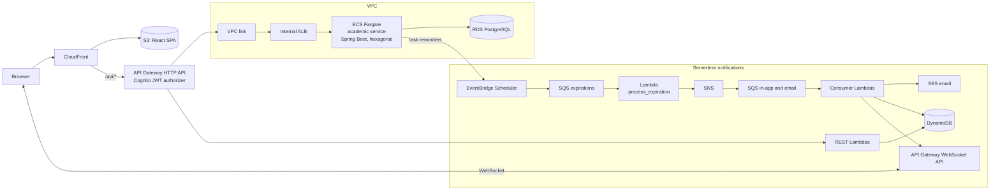

# UniFlow

UniFlow is an academic planner for university students: periods, courses and tasks with due dates, plus in-app and email reminders. This repository is the platform hub. It holds the AWS infrastructure (a single Terraform stack), the serverless notification backend (Lambdas), the local development environment and the architecture documentation. The application services live in their own repositories, listed below.

## Architecture


Editable source: [diagrams/Uniflow.drawio](diagrams/Uniflow.drawio). Request and notification flow in short:



- Authentication: Cognito user pool with Hosted UI (authorization code + PKCE). API Gateway validates the JWT; the academic service validates it again as an OAuth2 resource server.
- The SPA calls `/api/*` on its own CloudFront domain, so the API needs no CORS.
- Notifications are fully serverless: REST and WebSocket APIs, 11 Lambdas, DynamoDB, SQS with DLQs, SNS and SES.

More diagrams (CI/CD, notification pipeline, WebSocket handshake): [docs/architecture.md](docs/architecture.md).

## Repositories

Organization: [UniFlowProject](https://github.com/UniFlowProject)

| Repository | Role | Status |
| --- | --- | --- |
| [uniflow](https://github.com/UniFlowProject/uniflow) (this repo) | Terraform (`infra/`), notification Lambdas (`lambdas/`), local dev stack, docs | Active |
| [uniflow-academic-service](https://github.com/UniFlowProject/uniflow-academic-service) | Java 21, Spring Boot 3.5, PostgreSQL, Flyway. Periods, courses and tasks | Active |
| [uniflow-frontend](https://github.com/UniFlowProject/uniflow-frontend) | React 19, Vite, TanStack Router and Query, Tailwind, shadcn/ui (being renamed from `UniFlow-Frontend`) | Active |
| [uniflow-notification-service](https://github.com/UniFlowProject/uniflow-notification-service) | NestJS + MongoDB + Socket.IO. Replaced by the Lambdas here; kept as a local dev stand-in | Archived |
| [uniflow-tasks-service](https://github.com/UniFlowProject/uniflow-tasks-service) | Python/FastAPI tasks service. Merged into the academic service | Archived |

## Tech stack

- AWS: CloudFront, S3, API Gateway (HTTP and WebSocket), Cognito, VPC, internal ALB, ECS Fargate, ECR, RDS PostgreSQL, Lambda, DynamoDB, SQS, SNS, EventBridge Scheduler, SES, KMS, CloudWatch.
- Infrastructure as code: Terraform 1.15 with an S3 backend.
- Backend: Java 21 with Spring Boot (hexagonal architecture); Node.js 22 Lambdas with unit tests.
- Frontend: React, TypeScript, Vite.
- CI/CD: GitHub Actions authenticated to AWS with OIDC.
- Local: Docker Compose with Floci, an AWS emulator.

## Key decisions

Details in [docs/adr](docs/adr/README.md).

1. [API Gateway, VPC link and internal ALB in front of ECS](docs/adr/0001-api-gateway-vpc-link-internal-alb.md): replaced Cloud Map, which API Gateway could not resolve.
2. [Serverless notifications](docs/adr/0002-serverless-notifications.md): replaced a NestJS/MongoDB service whose Socket.IO connections do not fit API Gateway WebSocket.
3. [Tasks merged into the academic service](docs/adr/0003-tasks-merged-into-academic.md): one service and database for the period, course and task chain.
4. [A single Terraform stack](docs/adr/0004-single-terraform-stack.md): replaced four stacks coupled through SSM.
5. [GitHub Actions OIDC roles per repository](docs/adr/0005-github-actions-oidc-roles.md): no long-lived AWS keys.

## Run it locally

`docker-compose.dev.yml` starts Floci (Cognito, API Gateway, Lambda authorizer), PostgreSQL, MongoDB and the academic and notification services behind a local gateway. The academic and notification service repos must be cloned inside this directory (the compose build contexts are `./uniflow-academic-service` and `./uniflow-notification-service`).

```bash
docker compose -f docker-compose.dev.yml up -d --build
scripts/dev-smoke.sh
```

The full guide is [docs/local-development.md](docs/local-development.md) (in Spanish). The helper scripts are described in [scripts/README.md](scripts/README.md).

## Deploy

One `terraform apply` in `infra/` creates the whole platform. Prerequisites, apply order, the cheap demo profile, the migration from the old four stacks and required GitHub-side settings are in [infra/README.md](infra/README.md).

## CI/CD

- Each deployable repo has a GitHub Actions workflow that assumes its own IAM role through OIDC. There are no stored AWS access keys.
- academic service: build the jar, push the image to ECR, force a new ECS deployment.
- frontend: build, sync to S3, invalidate CloudFront (gated by the `production` environment).
- this repo: Lambda unit tests then `update-function-code` on push to `main` ([deploy-lambdas.yml](.github/workflows/deploy-lambdas.yml)); `terraform fmt`, `init` and `validate` on pull requests touching `infra/` ([terraform-validate.yml](.github/workflows/terraform-validate.yml)).
- Terraform is applied manually, not by CI.

## Repository layout

```
.
├── infra/                  Terraform: the single stack (see infra/README.md)
├── lambdas/                Notification Lambdas (Node.js) and build.sh
├── docker/                 Floci bootstrap and notification Dockerfile for local dev
├── docker-compose.dev.yml  Local platform
├── scripts/                dev-token.sh, dev-smoke.sh
├── diagrams/               Draw.io source and exported images
├── docs/
│   ├── adr/                Architecture decision records
│   ├── architecture.md     Diagrams
│   └── local-development.md
├── .github/workflows/      deploy-lambdas, terraform-validate
└── LICENSE                 MIT
```

The service repositories are separate Git repositories; the root `.gitignore` excludes them when cloned inside this directory.

## License

[MIT](LICENSE)
