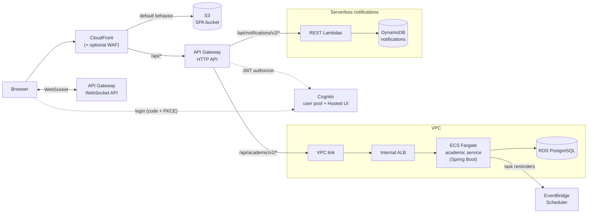
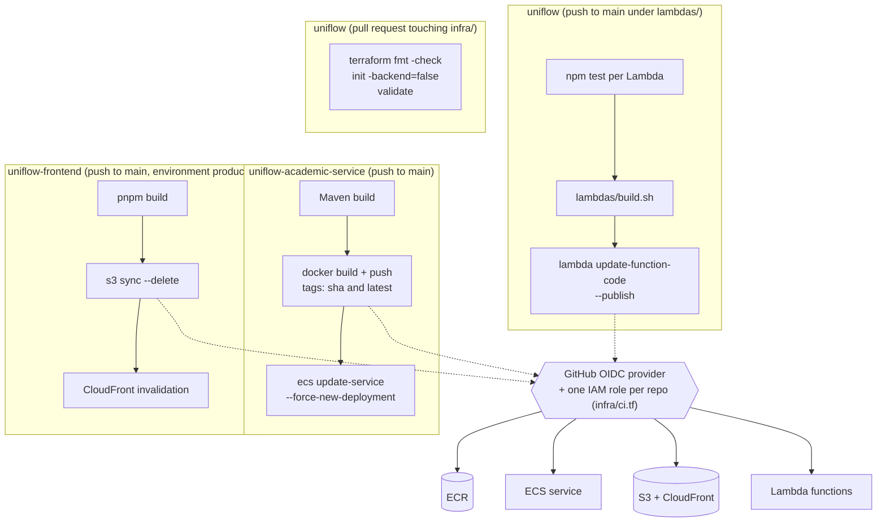
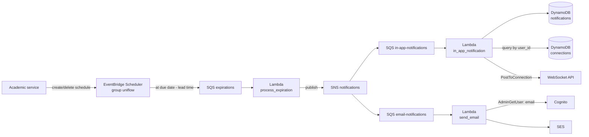
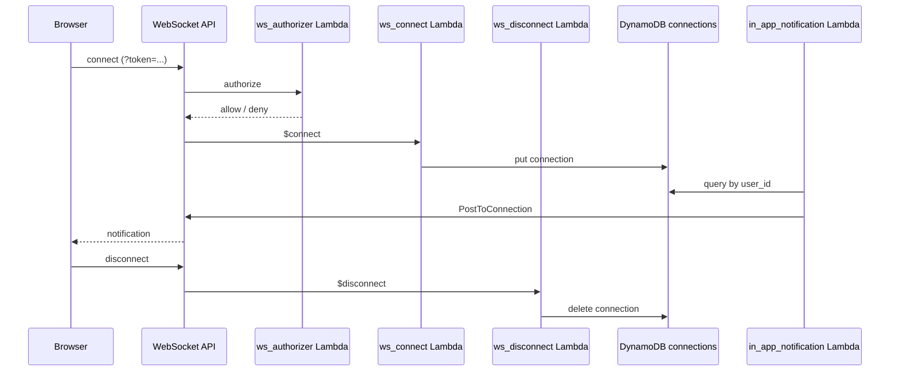

# Architecture

Diagrams of the deployed platform (AWS, one Terraform stack in [`infra/`](../infra/)). Names match the Terraform resources. Decisions are explained in [docs/adr](adr/README.md).

## System

Editable source: [diagrams/Uniflow.drawio](../diagrams/Uniflow.drawio).

The browser loads the SPA from CloudFront and calls `/api/*` on the same origin. CloudFront forwards `/api/*` to the HTTP API. Academic requests go through a VPC link to an internal ALB and on to ECS Fargate; notification requests go straight to Lambda. Both are protected by the same Cognito JWT authorizer.

The notification pipeline behind the Scheduler is drawn below.

## CI/CD

Each deployable repository has one GitHub Actions workflow and one IAM role assumed through GitHub OIDC (no stored AWS keys, see [ADR 0005](adr/0005-github-actions-oidc-roles.md)). CI ships artifacts only; infrastructure is applied with Terraform by hand.

The `terraform-validate` job uses no AWS credentials.

## Notification flow

Reminders start in the academic service (when `reminder_scheduler = "eventbridge"`, see `infra/academic.tf`), which creates one one-shot EventBridge Scheduler schedule per task. When it fires, the message lands in the `expirations` queue and fans out through SNS to the in-app and email queues. Every queue has a DLQ.

## WebSocket connection

The token travels in the `token` query string and is checked by a Lambda REQUEST authorizer. Connections are stored with a TTL attribute and looked up by `user_id` when a notification is pushed.

